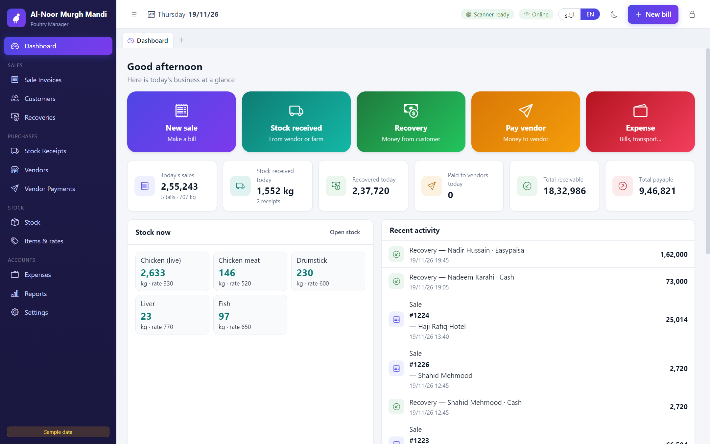
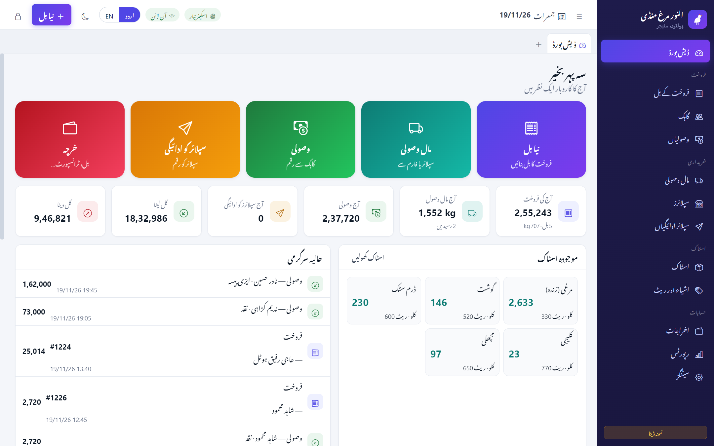
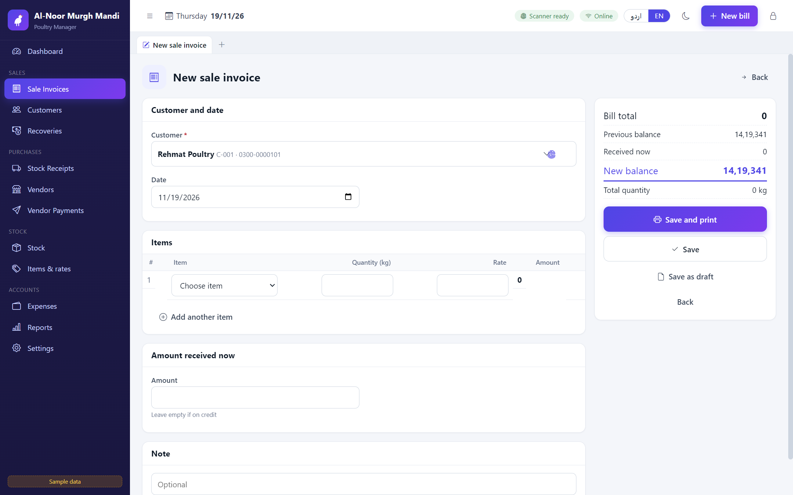
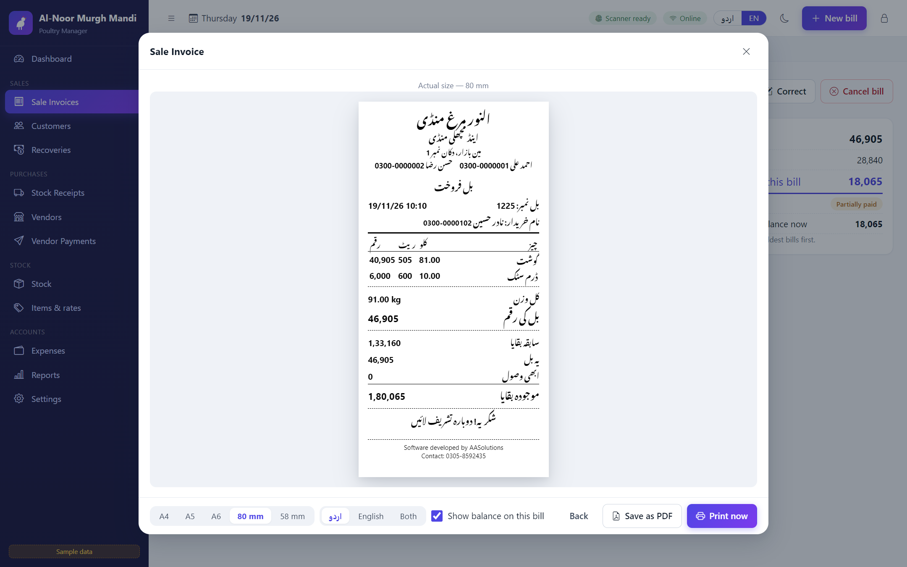
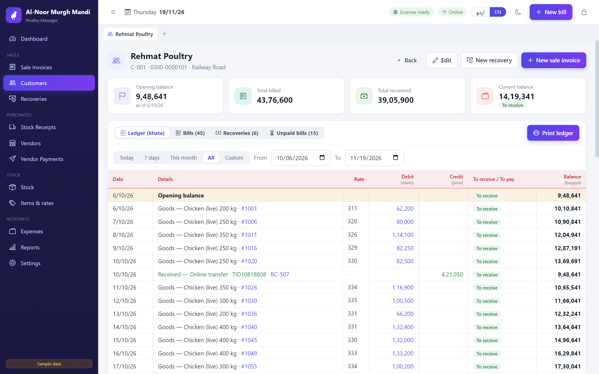
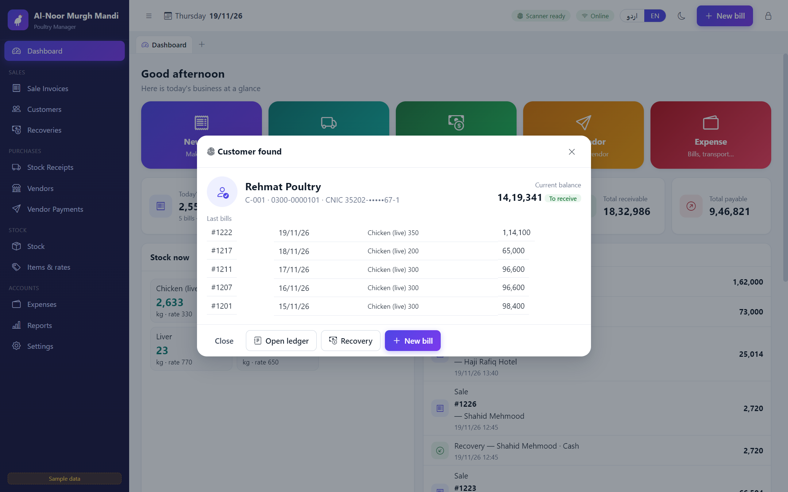
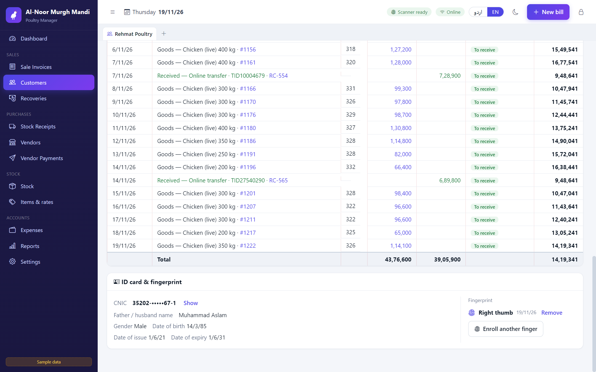
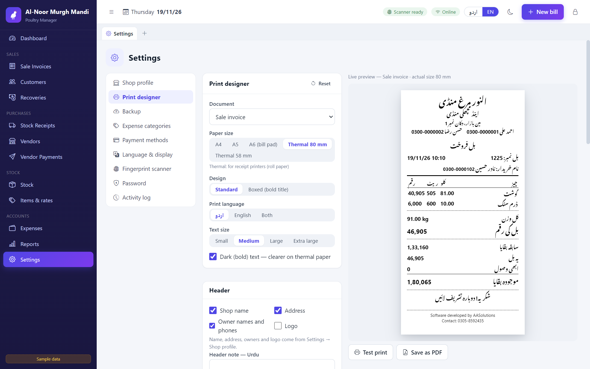
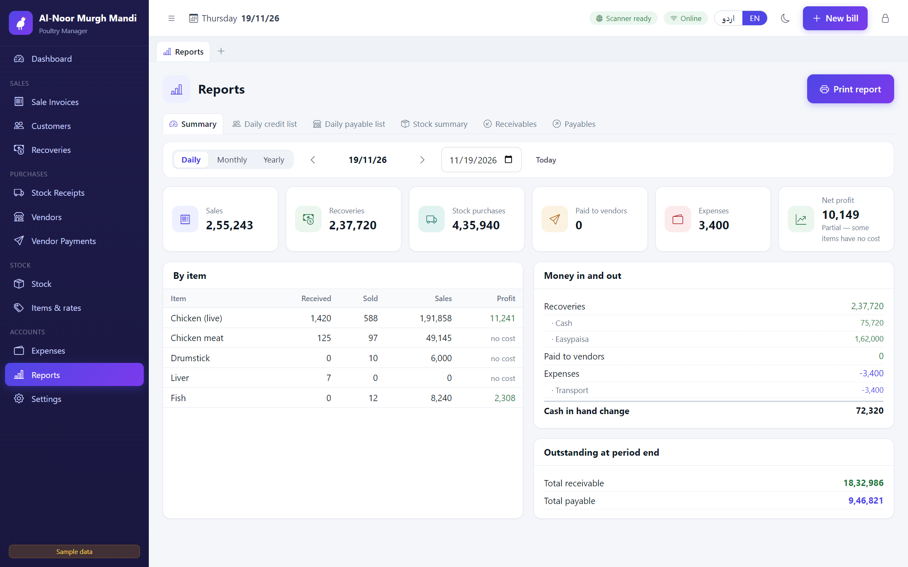

<div align="center">


# Poultry Manager

**Offline desktop software for poultry and meat shops: sales, stock, khata ledgers, recoveries, thermal receipts and fingerprint customer lookup.**

Urdu first, with English one click away · Works with no internet · Windows 10 / 11


[**⬇ Download the Windows installer**](https://github.com/AsadAli2k18/Poultry-Manager/releases/latest)



</div>

---

## Why it exists

A poultry shop runs on a register (کھاتہ): live birds and meat come in from vendors and the owner's own farm, and go out on credit to hotels, shops and regular customers. Money comes back in parts, in cash, by Easypaisa, JazzCash or bank. Poultry Manager replaces the register without changing how the shop works. Every bill updates stock and the customer's balance at once, and every rupee can be traced back to a bill or a payment.

## Features

| | |
|---|---|
| 🧾 **Sales & receipts** | Sale invoices with kg × rate lines, part payment at the counter, draft bills, corrections that keep the original on record |
| 🚚 **Stock in** | Stock receipts from vendors or the own farm, vendor bill photo, mortality and weight-loss corrections, live stock per item |
| 📒 **Khata ledgers** | Register-style customer and vendor ledgers (date, details, rate, debit, credit, balance), unpaid bills, printable statements |
| 💵 **Recoveries & payments** | Cash, Easypaisa, JazzCash, bank and cheque, with reference numbers and who handled them, linked to bills |
| 🖨️ **Thermal receipts** | 80 mm and 58 mm receipts sent straight to the printer (ESC/POS), cut after the last line, Urdu printed sharply, balance shown as of that bill |
| 🎨 **Print designer** | A4 / A5 / A6 and thermal layouts, header, columns, fonts, bill numbers, footer, live preview at actual size, Save as PDF |
| 🪪 **ID card (CNIC)** | Optional Pakistani CNIC details and card photos on each customer, with format, duplicate and expiry checks |
| ☝️ **Fingerprint lookup** | Optional SecuGen scanner. Place an enrolled finger and the customer appears, or is filled into the open bill |
| 📊 **Reports** | Daily and period summary, sales, stock movement, profit, receivables and payables, expenses |
| 🗂️ **Tabs** | Several bills and ledgers open side by side; a half-typed bill survives switching tabs |
| 💾 **Backups** | Scheduled and verified SQLite backups, USB copy, one-click restore with a safety copy first |
| 🔒 **Safe by design** | Nothing is ever deleted: cancellations reverse stock and balances and stay in the activity log |

## Screenshots

<table>
<tr>
<td width="50%"><br><sub><b>Urdu interface</b>: right-to-left with the Noto Nastaliq font</sub></td>
<td width="50%"><br><sub><b>New sale</b>: customer balance, lines, payment at the counter, draft</sub></td>
</tr>
<tr>
<td><br><sub><b>80 mm thermal receipt</b>: previous balance, this bill, received, current balance</sub></td>
<td><br><sub><b>Customer khata</b>: running balance, every bill and payment linked</sub></td>
</tr>
<tr>
<td><br><sub><b>Fingerprint lookup</b>: balance, last bills, New bill / Recovery / Ledger</sub></td>
<td><br><sub><b>CNIC & enrolled fingers</b>: masked number, expiry, card photos</sub></td>
</tr>
<tr>
<td><br><sub><b>Print designer</b>: thermal layout with live preview at actual width</sub></td>
<td><br><sub><b>Reports</b>: sales, stock, profit, receivables</sub></td>
</tr>
</table>

<sub>Screenshots use the built-in sample shop. All names and phone numbers in it are made up.</sub>

## Install on the shop PC

1. Download **`PoultryManager-Setup-1.0.0.exe`** from [Releases](https://github.com/AsadAli2k18/Poultry-Manager/releases/latest) and run it. Windows may say "Windows protected your PC" because the installer is not signed: click **More info → Run anyway**.
2. Open **Poultry Manager** from the desktop shortcut. The first password is `1234`. Change it in **Settings → Password**.
3. **Settings → Shop profile**: shop name, address and phone numbers.
4. **Items & rates**: items and opening stock. Then add customers and vendors with their opening balances.
5. **Settings → Backup**: choose the backup day and folder, then press **Backup now** once.

Nothing else is needed: no XAMPP, no browser, no internet.

### Optional hardware

| Device | Tested with | Setup |
|---|---|---|
| Thermal receipt printer | Black Copper BC-87AC (80 mm, USB) | Install the printer's Windows driver. The app sends receipts directly (ESC/POS), so the driver only has to provide the printer. Choose it in **Settings → Print designer → Printer**. |
| Fingerprint scanner | SecuGen Hamster Pro 20 (U20-AP) | Install SecuGen's driver for the scanner. The app finds it automatically ("Scanner ready" in the top bar). Enroll customers from their page. See [docs/FINGERPRINT-DESIGN.md](docs/FINGERPRINT-DESIGN.md). |

Both are optional. Without them, every screen works the same.

## Updates

Installed apps update themselves from this repository's [Releases](https://github.com/AsadAli2k18/Poultry-Manager/releases):

1. When the app opens, and every 6 hours, it checks for a newer release. Without internet it simply tries again later.
2. A new version downloads in the background, and a safety backup of the data is taken.
3. A bar offers **Restart to install**. **Later** installs it the next time the app is closed.

**Settings → Updates** shows the version and has **Check for updates**. Only published releases reach the shop. Commits and pushes on their own never do.

To publish an update:

```bash
npm run release -- 1.1.1 "What changed"
```

This sets the version, commits and pushes, builds the installer, and uploads it with `latest.yml` to a new GitHub Release.

## Where the data lives

| What | Where |
|---|---|
| Database (one file) | `Documents\PoultryManager\data\poultry.db` |
| Backups | `Documents\PoultryManager\Backups` (or the folder chosen in Settings), plus `PoultryManager-Backups` on a USB drive if one is plugged in |
| Safety copies (before a restore, an erase or loading sample data) | `Documents\PoultryManager\data\safety` |

Uninstalling the program never deletes this folder. Fingerprints are stored as templates (codes), never as pictures.

## Corrections

Nothing is ever deleted. Every change is kept in the activity log.

| Entry | Cancel | Correct |
|---|---|---|
| Sale invoice / stock receipt | ✓ stock and balance reversed | ✓ old one cancelled with a reason, new one linked to it |
| Recovery / vendor payment | ✓ | ✓ |
| Expense | ✓ | ✓ |
| Stock correction (mortality, weight loss…) | ✓ stock goes back | add a new one |
| Customer, vendor, item | edit (opening balance changes are logged) | |
| Fingerprint | remove (kept as inactive, logged) | enroll again |

## For developers

```bash
npm install            # Electron, SQLite (rebuilt for Electron automatically), build tools
npm run secugen -- "<FDx_SDK_Pro_Windows_….zip>"   # once: copies SecuGen's DLLs (not kept in git)
npm start              # run the app
npm test               # 120 end-to-end checks of the real app on a throwaway data folder
npm run screenshots    # refresh docs/screenshots from the sample shop
npm run dist           # build dist/PoultryManager-Setup-<version>.exe
npm run release -- 1.1.1 "notes"   # publish an update to every installed app
```

| Path | Contents |
|---|---|
| `desktop/main.js` | Electron shell: window, data folder, IPC, printing |
| `desktop/db.js` | SQLite schema (v3) and storage. Each record is kept as JSON, and its key fields are also real columns, so the data can be queried outside the app. |
| `desktop/backup.js` | Scheduler, verified backups, keep-N, USB copy, restore with a safety copy |
| `desktop/escpos.js` | Direct receipt printing: renders the bill at 203 dpi and sends ESC/POS raster + cut |
| `desktop/biometric.js` | Fingerprint scanner helper process (SecuGen), listening loop, 1:N matching, simulator |
| `desktop/updater.js` | Automatic updates from GitHub Releases (electron-updater) |
| `desktop/preload.js` | The only functions the screens can call (`window.PM`) |
| `app/js/store.js` | Data layer: stock, balances, ledgers and statuses computed from the entries; every change is on disk before the screen moves on |
| `app/js/print.js` | Bills, receipts and reports for paper and thermal printers |
| `app/js/bio.js` | CNIC and fingerprint screens |
| `app/` | Front end: Preact + htm with no build step. Libraries and the Urdu font are bundled in `app/vendor/`. |
| `tools/selftest/` | The `npm test` scripts (flows, restore, thermal, tabs and drafts, fingerprint) |
| `docs/` | Requirements (`SRS-v2.md`), build plan, fingerprint design |

---

<div align="center">

Developed by **AASolutions** · Contact: **0305-8592435**

</div>
